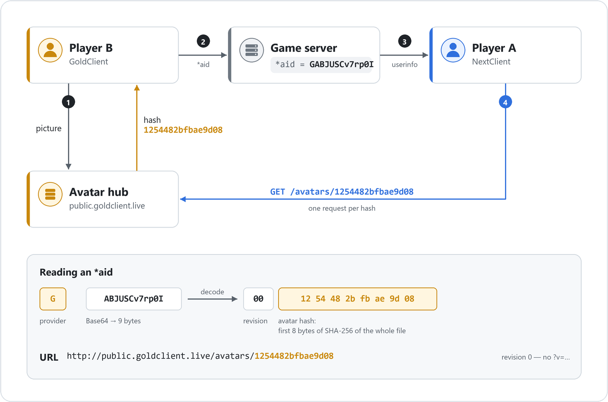

🌐 Available languages:  [Русский](README.ru.md) |  [English](README.md)

# GoldSrc Avatar Hub Protocol Concept
> ⚠️ This is currently a conceptual specification. \
The system is currently partially implemented. For detailed information, see the [Provider Status](#provider-status) section. \
As implementations progress, this document will be updated to reflect working standards.

## Annotation

This repository outlines the conceptual specification for a **decentralized, federated avatar system** for GoldSrc engine clients (such as Counter-Strike 1.6). \
The goal of this protocol is to provide a unified, efficient, and scalable method for different client modifications ( e.g., [GoldClient](https://goldclient.ru/en/), [NextClient](https://github.com/CS-NextClient/NextClient) ) to share and display custom player avatars without relying on a single, centralized server, thus preventing bottlenecks and single points of failure inherent in legacy systems.

The core principle is that **an avatar is named by the hash of its content**. \
A client announces only the name of its picture in `userinfo`, and everyone who sees it fetches the picture directly from the provider's hub. \
The file behind such a name never changes, so it can be served from a standard web server, and providers may optionally put a CDN or a reverse proxy in front of the hub for caching and scalability.

---

## Table of Contents

- [What is `*aid`?](#what-is-aid)
- [Why the avatar is named by its content hash](#why-content-hash)
- [Why decentralized?](#why-decentralized)
- [How it works](#how-it-works-protocol-flow)
- [Notes for server owners](#notes-for-server-owners)
- [Security Considerations](#security-considerations)
- [For Developers Wishing to Integrate](#for-devs)
- [Provider status](#provider-status)
- [Key Takeaways / Summary](#summary)

---

## What is `*aid`?

**AvatarID (`*aid`)** is a standardized, compact avatar identifier used in GoldSrc-based clients ( e.g., [GoldClient](https://goldclient.ru/en/), [NextClient](https://github.com/CS-NextClient/NextClient) ). \
It is transmitted via the player's `userinfo` string and lets independent clients show each other's avatars.

An `*aid` consists of two parts: \
`[Provider Prefix (1 char)]` + `Encoded block [Revision (1 byte) + Avatar Hash (8 bytes)]`

1. **Provider Prefix**
   * **Purpose:**
     Identifies which community (**provider**) hosts the avatar in its hub. \
     Clients use it to look up the right hub URL.
   * **Format:** A single, case-sensitive ASCII character.
   * **Examples:**
     * `G` : GoldClient
     * `N` : NextClient
     * `X` : SomeFuture Client

2. **Encoded block: Revision & Avatar Hash**
   * **Avatar Hash (8 bytes)** — the name under which the provider's hub stores the picture. \
     The hub computes SHA-256 over the entire content of the avatar file (as the hub stores and serves it) and takes the first 8 of the 32 resulting bytes. \
     The hub computes the hash on upload and returns it to the client; the client does not hash anything itself. \
     Identical pictures have identical hashes.
   * **Revision (1 byte, 0–255)** — the version of the picture under the same name; it goes into the URL as `?v=<revision>` so that caches along the way fetch the file again. \
     A hub that names pictures by their content hash always announces revision `0`: a new picture gets a new name. \
     A client reading someone else's `*aid` must honor a non-zero revision: append it to the URL and fetch the picture again when the revision changes for the same hash.
   * **Encoding:**
     * The revision and the hash are concatenated into a **9-byte binary block**: `[revision] + [8 hash bytes]`.
     * The block is encoded into a **12-character string** using standard Base64 (`RFC 4648, Section 4`); 9 bytes encode without trailing `=`.
     * See [encode_aid.cpp](cpp/examples/encode_aid.cpp) for a minimal encoding/decoding example.

   * Example `*aid`
     * `*aid : GABJUSCv7rp0I`
     * `G` → provider prefix (GoldClient)
     * `ABJUSCv7rp0I` → Base64-encoded 9-byte block **[Revision (1 byte) + Avatar Hash (8 bytes)]**
       * Step 1. Decode from Base64 → 9 raw bytes: `0x00 0x12 0x54 0x48 0x2b 0xfb 0xae 0x9d 0x08`
       * Step 2. Split the bytes:
         * First byte → `0x00` → **Revision 0**
         * Next 8 bytes → `0x12 ... 0x08` → **Avatar Hash**
       * Step 3. Write the hash as lowercase hex → `1254482bfbae9d08`
       * Result → the picture is at `http://public.goldclient.live/avatars/1254482bfbae9d08`

---

## <a id="why-content-hash"></a>Why the avatar is named by its content hash ##

- **One picture, one name.** Players with the same avatar announce the same `*aid`, and a client fetches the picture once.
- **The file behind a name never changes.** Clients, proxies and CDNs may keep it for as long as they like: a different picture is a different name.
- **Nothing about the player in `userinfo`.** `*aid` names only the picture and carries no data about the player or their computer.
- **One copy per picture in the hub.** Popular avatars are not duplicated on disk once per player.

---

## Why decentralized?

In the past, avatar systems often depended on a **centralized API or server**. \
This approach introduces several risks:
 - **Bus factor problem** — one admin becomes the single point of failure.
 - **Downtime risk** — if the central server is offline, the entire system breaks.
 - **Scalability limits** — the ecosystem depends on one maintainer or infrastructure.

**AvatarID avoids these issues:**
  - Each mod maintains its own **avatar hub** (web storage for uploaded avatars).
  - Clients exchange only `*aid` strings via `userinfo`.
  - A client can resolve an avatar URL using local provider configuration (prefix → URL template).

This ensures resilience, independence, and long-term sustainability.

---

## How It Works: Protocol Flow



1. **Avatar Selection & Upload:**
    * A player selects an avatar in their client (e.g., GoldClient, NextClient).
    * The client uploads it **to its own provider's hub**. How the upload works and who may make it is up to the provider.
    * The hub converts the picture to its own format, stores the file under its hash and returns the hash to the client.
    * The client builds the `*aid` from its provider prefix, revision `0` and the received hash, and starts broadcasting it in `userinfo`. \
      The client keeps the hash in its settings and announces it right away on later launches, without uploading again.

2. **Client-Side Identification & Configuration Lookup:**
    * When *Client A* observes another player (*Client B*), it reads *Client B's* `userinfo` to find the `*aid` key.
    * *Client A* extracts the provider prefix (first character) and maps it to the corresponding provider info from its preloaded local configuration, which contains URLs and metadata. \
      Example config:

    ```json
    "services": {
      "avatar": {
        "providers": {
          "G": { "url": "http://public.goldclient.live/avatars/{hash}" },
          "N": { "url": "http://avatars.nextclient.com/{hash}" },
          "S": { "url": "https://steamcommunity.com/profiles/{steamid64}?xml=1" },
          "X": { "url": "TBD" }
        }
      }
    }
    ```

    * Config updates are handled by the client: bundled with the mod, downloaded via an update server, or stored locally.
    * A client skips a prefix that is not in its configuration: such an `*aid` gives no avatar.

3. **Fetching the Avatar:**
    * *Client A* builds the avatar URL by substituting the hash for `{hash}` in the provider's URL template (note: **no extension is appended**):

      ```
      <Provider URL template>, where {hash} → the avatar hash as a lowercase hex string
      ```

      Example (revision = 0, no query parameter): \
      `http://public.goldclient.live/avatars/{hash}` → `http://public.goldclient.live/avatars/1254482bfbae9d08`
      <br/><br/>

      If the revision is greater than zero, it is appended to the resulting URL as a cache-busting query parameter:

      ```
      <Avatar URL> + "?v=" + <Revision>
      ```

      Example (`*aid : GAxJUSCv7rp0I`, revision = 3): \
      `http://public.goldclient.live/avatars/1254482bfbae9d08?v=3`
      <br/><br/>

    * *Client A* includes HTTP headers to declare capabilities:
        - `Accept` — which image formats it supports, e.g.:
          ```
          Accept: image/png;q=1.0, image/jpeg;q=0.8, image/webp;q=0.7
          ```
          Providers will serve the avatar in the best matching format. \
          By default, providers MUST respond `image/jpeg` for maximum compatibility.

        - `User-Agent` — identifies the client type and version. \
           It serves as standard HTTP identification and allows providers to differentiate requests by client type if needed:
          ```
            User-Agent: GoldClient/2.6.0.0
          ```

    * The avatar is fetched directly from the provider hub; no central server coordination is needed.
    * Players with the same `*aid` show one picture: it is fetched once and served from the cache for all of them.

---

## ⚠️ <a id="notes-for-server-owners"></a>Important Note for Server Administrators (ReHLDS) ##

This protocol relies on clients being able to share their `*aid` key via `userinfo`. \
If you have customized the `sv_rehlds_userinfo_transmitted_fields` cvar to optimize traffic, you **MUST** include the `*aid` key in the CVar.

- ✔️ **Default behavior (empty value):** all fields, including `*aid`, are transmitted.

- **Restricted configuration example:** \
  ❌ In this case, `*aid` will **not** be shared :
  ```bash
  sv_rehlds_userinfo_transmitted_fields "\name\model\*sid"
  ```
  ✔️ To enable AvatarID support, add `*aid` :
  ```bash
  sv_rehlds_userinfo_transmitted_fields "\name\model\*sid\*aid"
  ```

---

## Security Considerations

**`*aid`**
* The `*aid` is strictly an **avatar name** and **must not** be used for authentication or authorization purposes.
* Treat `*aid` values as **public information**. Any client may announce someone else's `*aid` and show someone else's picture — just as it may take someone else's nickname; this affects neither the picture other players see nor the file in the hub.

**Provider hub**
* The hub computes the file name **itself** from the stored bytes and never takes it from the client. Otherwise anyone could put their own picture under the name of a popular avatar.
* The name is a 64-bit prefix of the hash, so when a name already exists the hub compares the file content as well.
* The hub checks any name taken from a request against its format (16 hex characters) before using it in a file path.

**Client**
* Downloaded data is untrusted: check size and format before decoding the picture, and reject files beyond a reasonable limit.
* A decoded `*aid` block must be exactly 9 bytes; otherwise the `*aid` is skipped.

---

## <a id="for-devs"></a>For Developers Wishing to Integrate ##

This protocol is open for any GoldSrc modding project. \
To join the federated hub:

1. **Choose a unique Provider Prefix** for your project. \
   Please check with existing projects to avoid collisions.

2. **Announce `*aid`** with the hash your hub returned.
   * After an upload, take the hash from the hub's answer, build the `*aid` with revision `0` and update `userinfo`.
   * Keep the hash in the client's settings: on later launches the client announces it in `*aid` right away, without uploading the picture again.
   * If your hub stores a picture under a permanent name that does not change when the picture is replaced, increment the revision on every upload and keep it the same way.

3. **Implement a robust client-side caching strategy.** \
   To prevent unnecessary network traffic and reduce load on provider hubs, client **MUST** implement a local caching mechanism.
   * **The cache key is the picture, not the player:** `provider prefix` + `hash`. Players with the same `*aid` share one entry, and the picture is fetched once. If the revision changes for the same hash, fetch the picture again.
   * **In-Session Caching (Minimum Requirement):** \
     An avatar, once fetched, **MUST** be cached for the entire duration of the connection to the current server, including reconnects. \
     Do not re-fetch the same avatar multiple times on the same server.
   * **Orphan Avatar Lifetime (Best Practice):** \
     When a player leaves the server, their avatar **SHOULD NOT** be deleted from the cache immediately. \
     It is **highly recommended** to implement an "orphan" lifetime (e.g., 5 minutes). \
     This prevents re-fetching the avatar if the player quickly reconnects. \
     The avatar can be safely purged from memory after this grace period expires.
   * **Request pacing (Best Practice):** \
     When joining a full server, do not send all requests at once: keep a queue and limit the rate per hub (e.g., at most 10 requests per second, in bursts of up to 10).

4. **Set up a hosting backend** for storing and serving avatars.
   * Store each picture once under its hash: SHA-256 over the entire content of the stored file, the first 8 of the 32 bytes, as lowercase hex (e.g. `1254482bfbae9d08`). Serve it under that name without an extension.
   * Convert uploaded pictures to one format with the same encoder settings: then the same picture always yields the same bytes and the same hash. The recommended size is 64×64.
   * Return the hash to the client in the upload answer (the GoldClient hub uses the `Avatar-Hash` header).
   * A file under a hash name is never overwritten, so it can be served with a long `Cache-Control`. \
     *Using a CDN is optional for performance, but not required.*

5. **Use a dedicated subdomain for federated avatar sharing**. \
   This ensures that the shared avatars between clients are isolated from your main infrastructure, allowing you to maintain control and optionally opt out of sharing in the future.

6. **Add your project's information to the participants list**. \
   You can either contact existing hub members (like GoldClient, NextClient) to have your Provider Prefix and avatar hub URL added to their configuration manifests, \
   or submit a Pull Request to this repository by updating/adding in [provider status](#provider-status).

This collaborative approach allows all participating communities to benefit from a shared, robust avatar system while maintaining full control over their own infrastructure.

---

## Provider status

- 🟢 `G` → GoldClient  (URL template `http://public.goldclient.live/avatars/{hash}`)
- ⚪ `N` → NextClient  (URL template <code style="color:dimgray">*TBD*</code>)
- 🟢 `S` → SteamClient (URL template `https://steamcommunity.com/profiles/{steamid64}?xml=1`)
- More providers may join by defining their prefix and hub rules.

---

## <a id="summary"></a>Key Takeaways / Summary ##

- `*aid` is a compact avatar name: the provider prefix and the content hash of the picture.
- Identical pictures have the same `*aid`: they are fetched once, and the hub keeps one copy.
- The file behind a hash name never changes, so it can be cached without limits.
- Clients resolve avatars independently using local configuration (provider prefix → URL template).
- No single, centralized server is required; each mod maintains its own avatar hub.
- Configurable `userinfo` fields (`*aid`) must be transmitted for correct sharing.
- The `*aid` block is encoded using standard Base64 (`RFC 4648, Section 4, standard alphabet`), ensuring interoperability and avoiding custom alphabet pitfalls.
