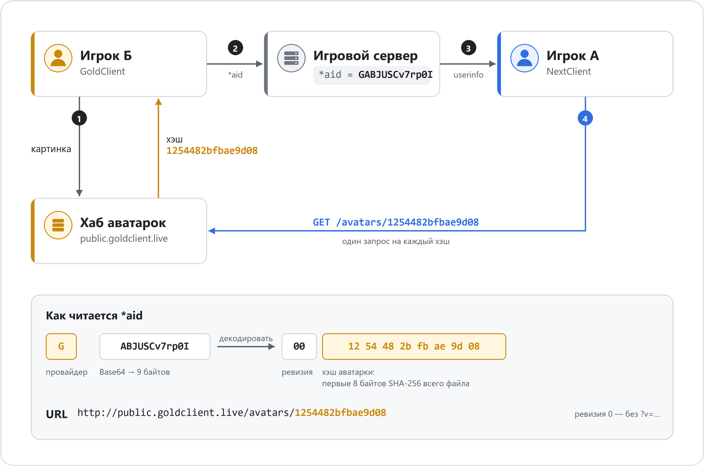

🌐 Доступные языки:  [Русский](README.ru.md) |  [English](README.md)

# Концепция протокола GoldSrc Avatar Hub
> ⚠️ Это концептуальная спецификация. На данный момент система внедрена частично. \
Подробную информацию см. в разделе [Статус провайдеров](#статус-провайдеров). \
По мере развития реализаций этот документ будет обновляться и уточняться.

## Введение

Этот репозиторий описывает концептуальную спецификацию **децентрализованной федеративной системы аватаров** для клиентов на движке GoldSrc (например, Counter-Strike 1.6). \
Цель протокола — обеспечить единый, эффективный и масштабируемый способ для различных клиентских модификаций ( например, [GoldClient](https://goldclient.ru/), [NextClient](https://github.com/CS-NextClient/NextClient) ) делиться и отображать пользовательские аватары без единого централизованного сервера, тем самым устраняя узкие места и риски отказа, характерные для старых систем.

Ключевой принцип — **аватарка называется хэшем своего содержимого**. \
Клиент объявляет в `userinfo` только имя картинки, а каждый, кто его видит, сам скачивает её напрямую с хаба провайдера. \
Файл под таким именем никогда не меняется, поэтому его можно раздавать с обычного веб-сервера, а провайдеры при желании могут поставить перед хабом CDN или обратный прокси для кэширования и масштабируемости.

---

## Содержимое

- [Что такое `*aid`?](#что-такое-aid)
- [Почему имя аватарки — хэш её содержимого](#почему-хэш-содержимого)
- [Зачем децентрализация?](#зачем-децентрализация)
- [Как это работает](#как-это-работает)
- [Заметки для админов серверов](#примечания-для-администраторов-серверов)
- [Вопросы безопасности](#вопросы-безопасности)
- [Для разработчиков](#для-разработчиков)
- [Статус провайдеров](#статус-провайдеров)
- [Итоги](#итоги)

---

## Что такое `*aid`?

**AvatarID (`*aid`)** — это стандартизированный компактный идентификатор аватарки, используемый в клиентах на движке GoldSrc ( например, [GoldClient](https://goldclient.ru/en/), [NextClient](https://github.com/CS-NextClient/NextClient) ). \
Он передаётся через строку `userinfo` игрока и позволяет разным независимым клиентам показывать аватарки друг друга.

`*aid` состоит из двух частей: \
`[Префикс провайдера (1 символ)]` + `Закодированный блок [Ревизия (1 байт) + Хэш аватарки (8 байтов)]`

1. **Префикс провайдера**
   * **Назначение:**
     Определяет, в хабе какого сообщества (провайдера) лежит аватарка. \
     По нему клиенты находят нужный URL хаба.
   * **Формат:** Один символ ASCII (чувствительный к регистру).
   * **Примеры:**
     * `G` : GoldClient
     * `N` : NextClient
     * `X` : Другой клиент

2. **Закодированный блок: Ревизия и Хэш аватарки**
   * **Хэш аватарки (8 байтов)** — имя, под которым хаб провайдера хранит картинку. \
     Хаб считает SHA-256 от всего содержимого файла аватарки (в том виде, в каком он его хранит и отдаёт) и берёт первые 8 из 32 байтов результата. \
     Хэш считает хаб при загрузке и возвращает клиенту; клиенту самому ничего хэшировать не нужно. \
     У одинаковых картинок одинаковый хэш.
   * **Ревизия (1 байт, 0–255)** — версия картинки под тем же именем; попадает в URL как `?v=<ревизия>`, чтобы кэши по пути взяли файл заново. \
     Хаб, который называет картинки хэшем содержимого, всегда объявляет ревизию `0`: новая картинка получает новое имя. \
     Клиент, читающий чужой `*aid`, обязан учитывать ненулевую ревизию: добавлять её к URL и скачивать картинку заново, если при том же хэше сменилась ревизия.
   * **Кодирование:**
     * Ревизия и хэш объединяются в **9-байтовый бинарный блок**: `[ревизия] + [8 байтов хэша]`.
     * Блок кодируется в **12-символьную строку** стандартным Base64 (`RFC 4648, раздел 4`); 9 байтов кодируются без `=` в конце.
     * См. [encode_aid.cpp](cpp/examples/encode_aid.cpp) — минимальный пример кодирования и декодирования.

   * Пример `*aid`
     * `*aid : GABJUSCv7rp0I`
     * `G` → префикс провайдера (GoldClient)
     * `ABJUSCv7rp0I` → 9-байтовый блок в Base64 **[Ревизия (1 байт) + Хэш аватарки (8 байтов)]**
       * Шаг 1. Декодировать из Base64 → 9 байтов: `0x00 0x12 0x54 0x48 0x2b 0xfb 0xae 0x9d 0x08`
       * Шаг 2. Разделить байты:
         * Первый байт → `0x00` → **Ревизия 0**
         * Следующие 8 байтов → `0x12 ... 0x08` → **Хэш аватарки**
       * Шаг 3. Записать хэш в hex в нижнем регистре → `1254482bfbae9d08`
       * Итог → картинка лежит по адресу `http://public.goldclient.live/avatars/1254482bfbae9d08`

---

## <a id="почему-хэш-содержимого"></a>Почему имя аватарки — хэш её содержимого ##

- **Одна картинка — одно имя.** Игроки с одинаковой аватаркой объявляют одинаковый `*aid`, и клиент скачивает картинку один раз.
- **Файл по имени никогда не меняется.** Клиенты, прокси и CDN могут хранить его сколько угодно: другая картинка — это другое имя.
- **В `userinfo` нет ничего об игроке.** `*aid` называет только картинку и не несёт сведений ни об игроке, ни о его компьютере.
- **Хаб хранит одну копию на картинку.** Популярные аватарки не размножаются на диске по числу игроков.

---

## Зачем децентрализация?

Раньше системы аватаров опирались на **централизованный API или сервер**.
Это влечёт за собой риски:
 - **Фактор автобуса** — один админ становится точкой отказа.
 - **Риск простоя** — если сервер упал, система ломается полностью.
 - **Ограничения масштабируемости** — всё завязано на одного человека или инфраструктуру.

**AvatarID решает эти проблемы:**
  - Каждый мод поддерживает свой **аватар-хаб** (хранилище для аватаров).
  - Клиенты обмениваются только строками `*aid` через `userinfo`.
  - Клиент может получить URL аватара из локальной конфигурации (префикс → шаблон URL).

Это даёт устойчивость, независимость и долговечность.

---

## <a id="как-это-работает"></a>Как это работает: Схема протокола ##



1. **Выбор и загрузка аватарки:**
    * Игрок выбирает аватарку в своём клиенте (например, GoldClient, NextClient).
    * Клиент загружает её **в хаб своего провайдера**. Как устроена загрузка и кто вправе её делать, решает провайдер.
    * Хаб приводит картинку к своему формату, сохраняет файл под его хэшем и возвращает хэш клиенту.
    * Клиент собирает `*aid` из префикса своего провайдера, ревизии `0` и полученного хэша и начинает передавать его в `userinfo`. \
      Хэш клиент запоминает в своих настройках и при следующих запусках объявляет сразу, без новой загрузки.

2. **Идентификация на стороне клиента и поиск в конфигурации:**
    * Когда *Клиент А* видит другого игрока (*Клиент Б*), он читает `userinfo` *Клиента Б*, чтобы найти ключ `*aid`.
    * *Клиент А* извлекает префикс провайдера (первый символ) и сопоставляет его с информацией о провайдере из своей предварительно загруженной локальной конфигурации, которая содержит URL и метаданные. \
      Пример конфигурации:

    ```json
    "services": {
      "avatar": {
        "providers": {
          "G": { "url": "http://public.goldclient.live/avatars/{hash}" },
          "N": { "url": "http://avatars.nextclient.com/{hash}" },
          "S": { "url": "https://steamcommunity.com/profiles/{steamid64}?xml=1" },
          "X": { "url": "TBD" }
        }
      }
    }
    ```

    * Обновление конфигурации обрабатывается клиентом: поставляется вместе с модом, загружается через сервер обновлений или хранится локально.
    * Префикс, которого нет в конфигурации, клиент пропускает: аватарки из такого `*aid` нет.

3. **Получение аватарки:**
    * *Клиент А* формирует URL аватарки, подставляя хэш в шаблон URL провайдера вместо `{hash}` (примечание: **расширение не добавляется**):

      ```
      <Шаблон URL провайдера>, где {hash} → хэш аватарки в hex в нижнем регистре
      ```

      Пример (ревизия = 0, без query-параметра): \
      `http://public.goldclient.live/avatars/{hash}` → `http://public.goldclient.live/avatars/1254482bfbae9d08`
      <br/><br/>

      Если ревизия больше нуля, она добавляется к получившемуся URL как query-параметр для обхода кэша:

      ```
      <URL аватарки> + "?v=" + <Ревизия>
      ```

      Пример (`*aid : GAxJUSCv7rp0I`, ревизия = 3): \
      `http://public.goldclient.live/avatars/1254482bfbae9d08?v=3`
      <br/><br/>

    * *Клиент A* ДОЛЖЕН включать в HTTP заголовки:
        - `Accept` — какие форматы изображений поддерживаются, например:
          ```
          Accept: image/png;q=1.0, image/jpeg;q=0.8, image/webp;q=0.7
          ```
          Провайдеры будут отдавать аватарку в наиболее подходящем формате. \
          По умолчанию провайдеры ДОЛЖНЫ отвечать `image/jpeg` для максимальной совместимости.

        - `User-Agent` — определяет тип и версию клиента. \
           Это служит стандартной идентификацией HTTP и позволяет хабам аватарок различать запросы по типу клиента при необходимости:
          ```
            User-Agent: GoldClient/2.6.0.0
          ```

    * Аватар загружается напрямую с хаба провайдера; координация через центральный сервер не требуется.
    * Игроки с одинаковым `*aid` показывают одну картинку: она скачивается один раз и берётся из кэша для всех.

---

## ⚠️ <a id="примечания-для-администраторов-серверов"></a>Важное примечание для администраторов серверов (ReHLDS) ##

Этот протокол зависит от возможности клиентов обмениваться ключом `*aid` через `userinfo`. \
Если вы изменили квар `sv_rehlds_userinfo_transmitted_fields` для оптимизации трафика, вы **ДОЛЖНЫ** включить ключ `*aid` в этот квар.

- ✔️ **Поведение по умолчанию (пустое значение):** передаются все поля, включая `*aid`.

- **Пример ограниченной конфигурации:** \
  ❌ В этом случае `*aid` **не будет** передаваться:
  ```bash
  sv_rehlds_userinfo_transmitted_fields "\name\model\*sid"
  ```
  ✔️ Чтобы включить поддержку AvatarID, добавьте `*aid`:
  ```bash
  sv_rehlds_userinfo_transmitted_fields "\name\model\*sid\*aid"
  ```

---

## Вопросы безопасности

**`*aid`**
* `*aid` — это исключительно **имя аватарки** и **не должен** использоваться для аутентификации или авторизации.
* Считайте значения `*aid` **публичной информацией**. Любой клиент может объявить у себя чужой `*aid` и показывать чужую картинку — так же, как может взять чужой ник; на картинку у других игроков и на файл в хабе это не влияет.

**Хаб провайдера**
* Имя файла хаб считает **сам** по сохранённым байтам и никогда не берёт его у клиента. Иначе кто угодно мог бы положить свою картинку под именем популярной аватарки.
* Имя — это 64-битный префикс хэша, поэтому при совпадении имени хаб сверяет и содержимое файлов.
* Любое имя из запроса хаб проверяет по формату (16 hex-символов), прежде чем использовать его в пути к файлу.

**Клиент**
* Скачанные данные недоверенные: проверяйте размер и формат до декодирования картинки и не принимайте файлы больше разумного предела.
* Декодированный блок `*aid` должен быть ровно 9 байтов; иначе `*aid` пропускается.

---

## <a id="для-разработчиков"></a>Для разработчиков, желающих интегрироваться ##

Этот протокол открыт для любого проекта по моддингу GoldSrc. \
Чтобы присоединиться к федеративному хабу:

1. **Выберите уникальный Префикс Провайдера** для вашего проекта. \
   Пожалуйста, сверьтесь с существующими проектами, чтобы избежать коллизий.

2. **Объявляйте `*aid`** с хэшем, который вернул ваш хаб.
   * После загрузки возьмите хэш из ответа хаба, соберите `*aid` с ревизией `0` и обновите `userinfo`.
   * Запомните хэш в настройках клиента: при следующих запусках клиент сразу объявляет его в `*aid`, не загружая картинку заново.
   * Если ваш хаб хранит картинку под постоянным именем, которое не меняется при её замене, увеличивайте ревизию при каждой загрузке и запоминайте её так же.

3. **Реализуйте надежную стратегию кэширования на стороне клиента.** \
   Чтобы предотвратить избыточный сетевой трафик и снизить нагрузку на хабы провайдеров, клиент **ОБЯЗАН** реализовывать локальный механизм кэширования.
   * **Ключ кэша — картинка, а не игрок:** `префикс провайдера` + `хэш`. Игроки с одинаковым `*aid` делят одну запись, и картинка скачивается один раз. Если у того же хэша сменилась ревизия, картинку нужно скачать заново.
   * **Кэширование в рамках сессии (Минимальное требование):** \
     Загруженная аватарка **ДОЛЖНА** кэшироваться на всё время подключения к **текущему** серверу, включая переподключения. \
     Не следует повторно запрашивать одну и ту же аватарку несколько раз на одном и том же сервере.
   * **Время жизни "осиротевших" аватарок (Лучшая практика):** \
     Когда игрок покидает сервер, его аватарка **НЕ ДОЛЖНА** удаляться из кэша немедленно. \
     **Настоятельно рекомендуется** реализовать время жизни для "осиротевших" аватарок (например, 5 минут). \
     Это предотвратит повторную загрузку аватарки, если игрок постоянно переподключается. \
     Аватарку можно безопасно удалить из памяти по истечении этого льготного периода.
   * **Темп запросов (Лучшая практика):** \
     При входе на заполненный сервер не отправляйте все запросы разом: держите очередь и ограничивайте темп к одному хабу (например, не чаще 10 запросов в секунду, пачкой до 10).

4. **Настройте бэкенд для хостинга** и раздачи аватарок.
   * Храните каждую картинку один раз под её хэшем: SHA-256 от всего содержимого сохранённого файла, первые 8 из 32 байтов, в hex в нижнем регистре (например `1254482bfbae9d08`). Отдавайте её по этому имени без расширения.
   * Приводите загруженные картинки к одному формату с одними и теми же настройками кодирования: тогда одна и та же картинка всегда даёт одни и те же байты и один хэш. Рекомендуемый размер — 64×64.
   * Возвращайте хэш клиенту в ответе на загрузку (хаб GoldClient — в заголовке `Avatar-Hash`).
   * Файл под именем-хэшем никогда не перезаписывается, поэтому его можно отдавать с долгим `Cache-Control`. \
     *Использование CDN является опциональным для производительности, но не обязательным.*

5. **Используйте выделенный поддомен для федеративного обмена аватарками.** \
   Это гарантирует, что общие аватарки между клиентами будут изолированы от вашей основной инфраструктуры, позволяя вам сохранять контроль и при необходимости в будущем отказаться от участия в обмене.

6. **Добавьте информацию о своём моде в список участников**. \
   Вы можете либо связаться с существующими участниками хаба (такими как GoldClient, NextClient), чтобы ваш Префикс Провайдера и URL хаба аватарок были добавлены в их конфигурацию, \
   либо отправить Pull Request в этот репозиторий, обновив/добавив свои данные в [статус провайдеров](#статус-провайдеров).

Такой совместный подход позволяет всем участвующим сообществам извлечь выгоду из общей, надежной системы аватарок, сохраняя при этом полный контроль над своей собственной инфраструктурой.

---

## <a id="статус-провайдеров"></a>Статус провайдеров ##

- 🟢 `G` → GoldClient  (шаблон URL `http://public.goldclient.live/avatars/{hash}`)
- ⚪ `N` → NextClient  (шаблон URL <code style="color:dimgray">*TBD*</code>)
- 🟢 `S` → SteamClient (шаблон URL `https://steamcommunity.com/profiles/{steamid64}?xml=1`)
- Другие провайдеры могут присоединиться, определив свой префикс и правила хаба.

---

## <a id="Итоги"></a>Ключевые моменты / Итог ##

- `*aid` — компактное имя аватарки: префикс провайдера и хэш содержимого картинки.
- Одинаковые картинки имеют одинаковый `*aid`: их скачивают один раз, а хаб хранит одну копию.
- Файл под именем-хэшем не меняется, поэтому его можно кэшировать без ограничений.
- Клиенты определяют URL аватарок независимо, используя локальную конфигурацию (префикс провайдера → шаблон URL).
- Единый, централизованный сервер не требуется; каждая модификация поддерживает свой собственный хаб аватарок.
- Для корректного обмена необходимо, чтобы на игровых серверах передавались настраиваемые поля `userinfo` (`*aid`).
- Блок `*aid` кодируется стандартным Base64 (`RFC 4648, Раздел 4, стандартный алфавит`), что обеспечивает совместимость и позволяет избежать проблем с кастомными алфавитами.
